# Hi, I'm Luis.

I turn ideas into things people can explore, use and share. My work spans family memories, music, team insight, learning and games.

For my professional background and experience, visit [luisoreamuno.com](https://luisoreamuno.com). The project source code stays private; this page shares screenshots, prototypes and the tools behind them.

## Famili

A private place for family stories, photographs and shared memories. Questions, albums, music and playful activities give different generations ways to contribute.

**Built with:** HTML, CSS and JavaScript; Supabase for accounts and private media in the existing app.

**Approach:** Shaped around my own family's use, with new Today, Stories and Play ideas explored in a separate local prototype.

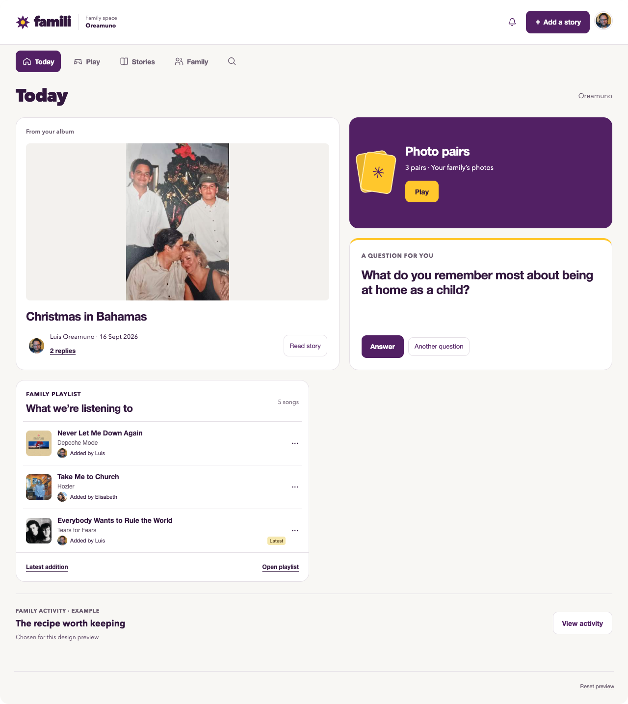

*Famili 3.0 design prototype. Screenshots combine real family photographs with example content; this interface is separate from the existing app.*

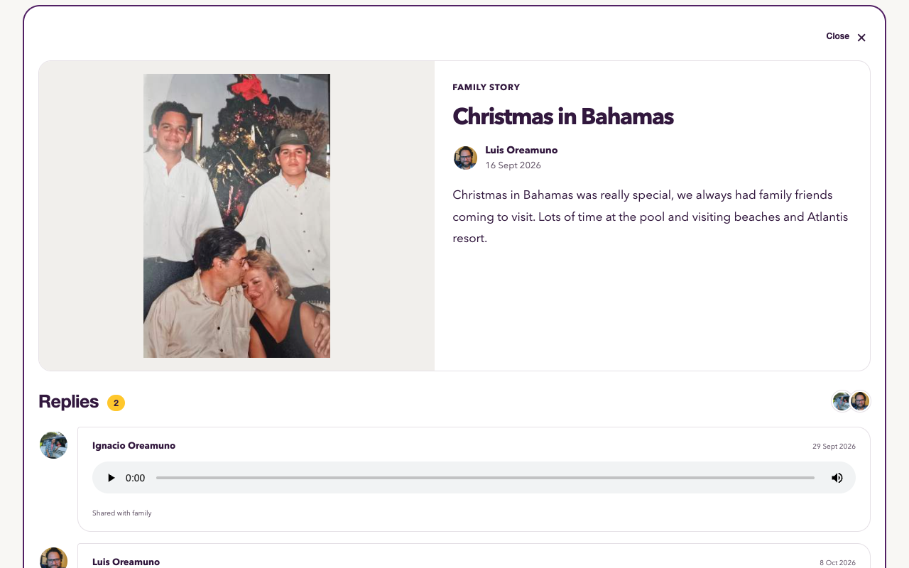

*Story and replies · prototype layout with family photographs and example content.*

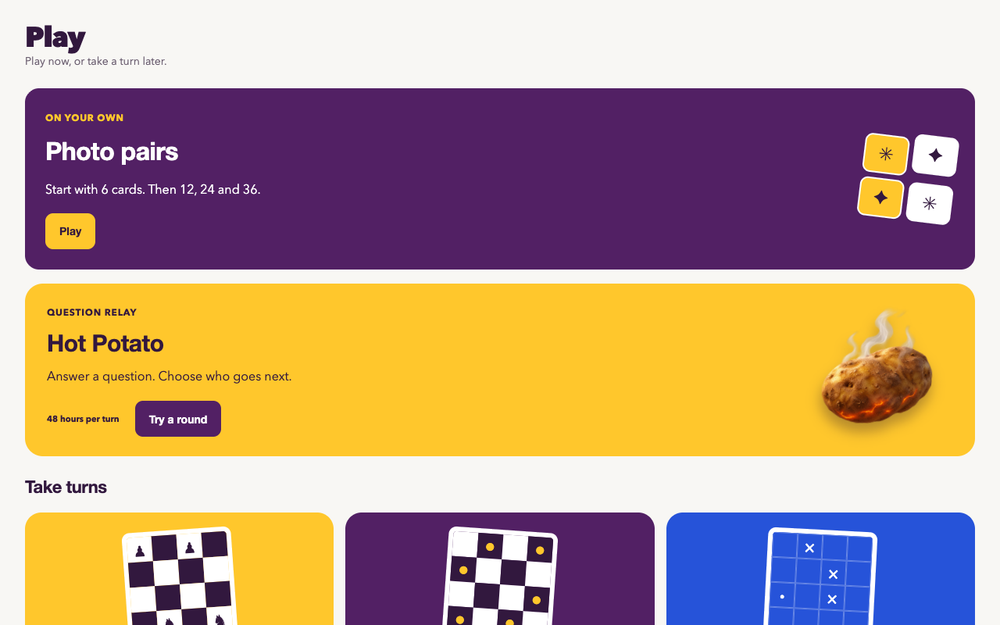

*Play · local prototype.*

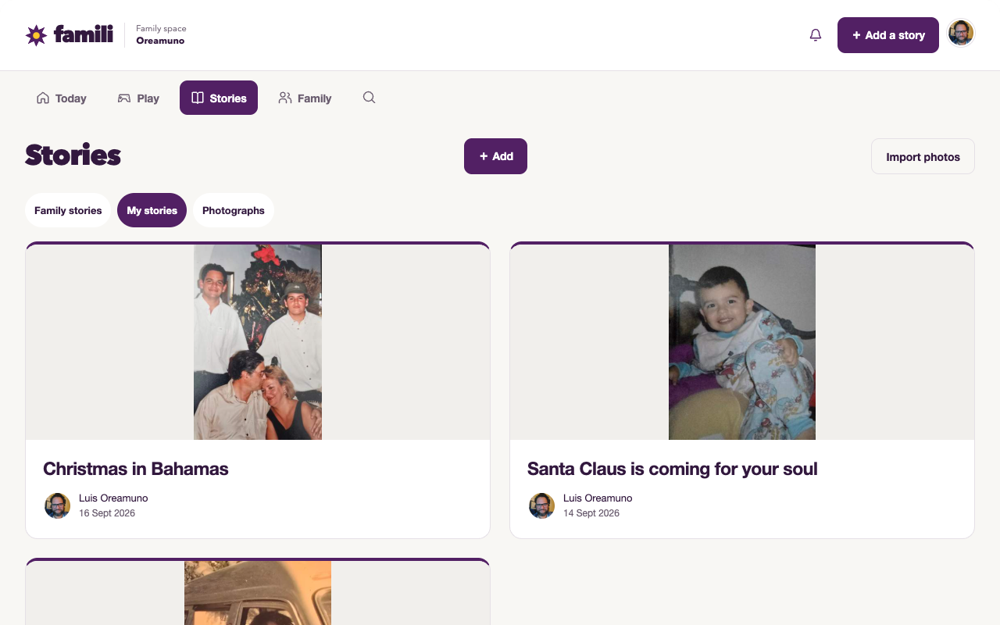

*Stories · prototype layout using family photographs.*

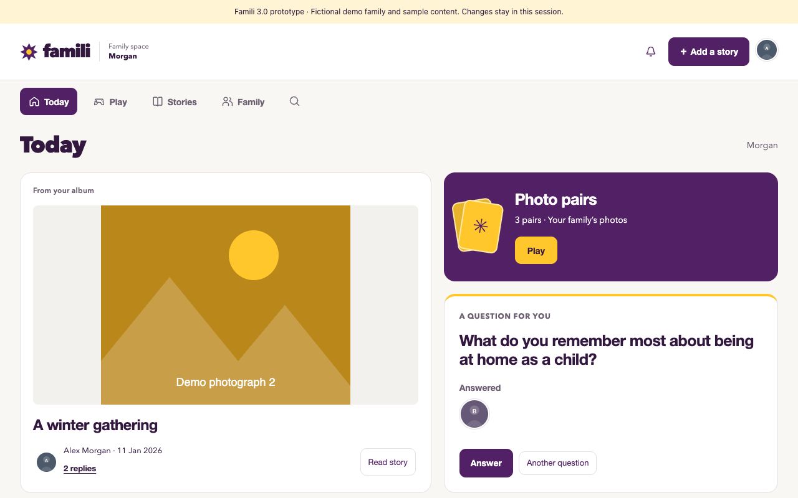

*Question responses · fictional demo family and example activity.*

## Guevara Drive

A journey into game creation, exploring space travel, planetary encounters and movement set to music. This earlier slingshot prototype explores approaching a planet and using its gravity to build speed.

**Built with:** JavaScript and HTML Canvas 2D, with custom flight controls and rendering.

**Approach:** Developed as playable studies, iterating on steering, planetary flybys and the feeling of speed.

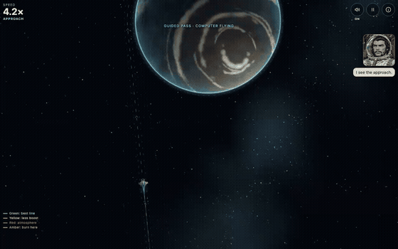

*Guided capture from the earlier slingshot prototype. The computer is flying; the game is still in development.*

## Senseeing

An exploration of how teams can bring different perspectives together, find gaps between assumptions and reality, and turn what people know into clearer decisions.

**Built with:** Next.js (React), TypeScript and PostgreSQL with Prisma for the product; HTML, CSS and JavaScript for the public website.

**Approach:** Explored through working prototypes that connect team contributions, shared priorities and visible follow-up.

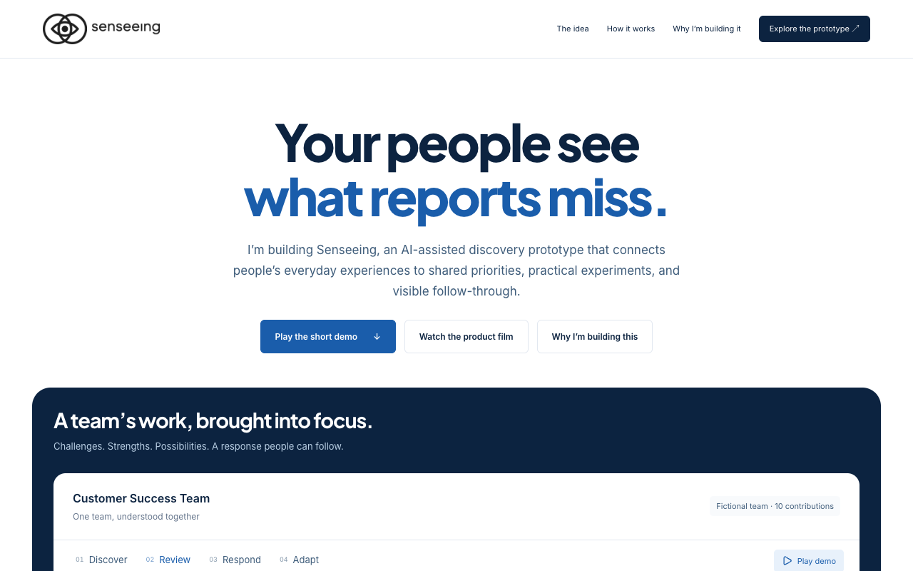

*Public Senseeing website.*

## Circle8

Share songs with friends in a private circle, add a message or voice introduction, and discover the music they share back. The project includes a website and apps for Android and iPhone.

**Built with:** HTML, CSS and JavaScript, with Capacitor for Android and iPhone and Supabase for accounts and data.

**Approach:** Developed from Ignacio's designs, sharing a web interface across the phone apps and adding device-specific features.

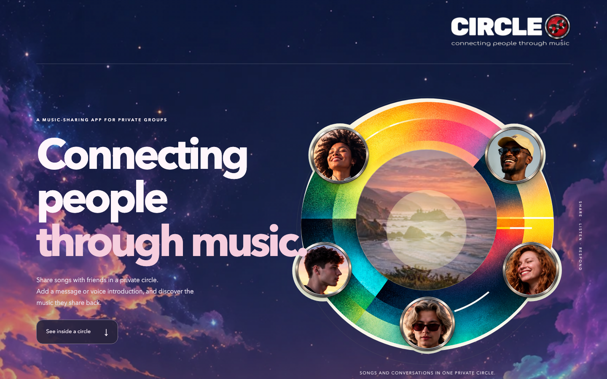

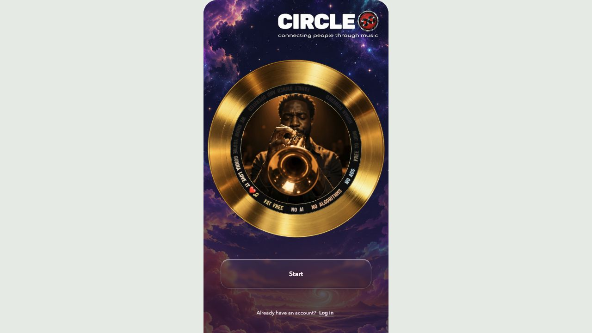

*Website and app design captures. Android and iPhone builds submitted to the app stores.*

## A different way to introduce myself

An interactive portfolio that brings together my experience, the work I care about and how I approach new ideas.

**Built with:** HTML, CSS and JavaScript, with custom animation and interaction.

**Approach:** Refined through layout and motion studies into the Listen, Find and Build experience.

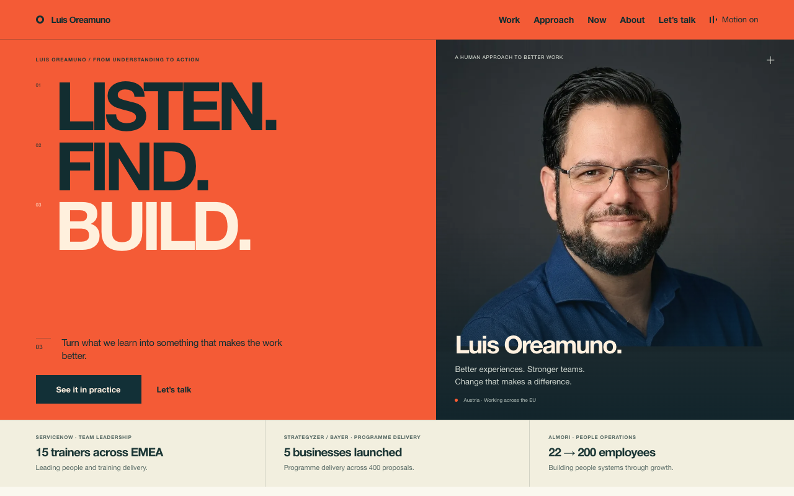

*Current public website. For my professional background and experience, visit [luisoreamuno.com](https://luisoreamuno.com).*

## Fazore

A website for work spanning AI learning, practical advice and building ideas into products.

**Built with:** HTML, CSS and JavaScript, hosted on Vercel.

**Approach:** Developed through copy and layout iterations to explain Fazore's advice, practical solutions and training in English and German.

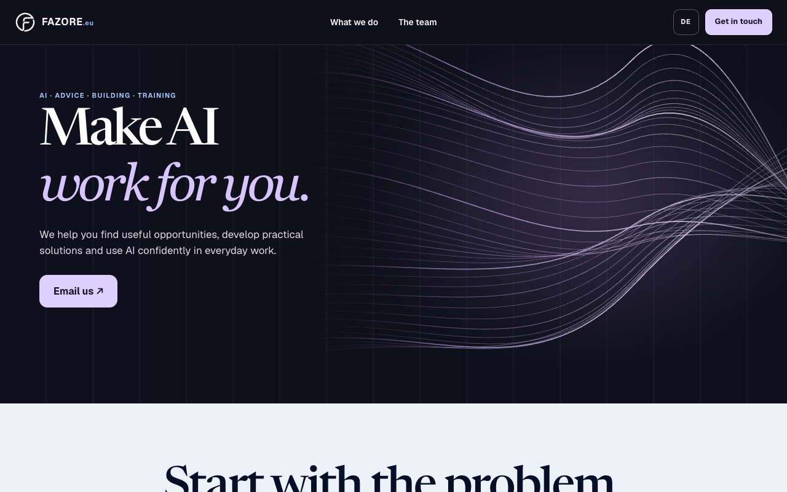

*Current public website: [fazore.eu](https://fazore.eu).*

## Sebastian Oreamuno

A portfolio website for my son, an advertising student, to present his university work, campaign ideas and visual explorations.

**Built with:** HTML, CSS and JavaScript, with PDF project presentations, hosted on Vercel.

**Approach:** Organized his university work into filterable projects, keeping academic context and individual credits visible.

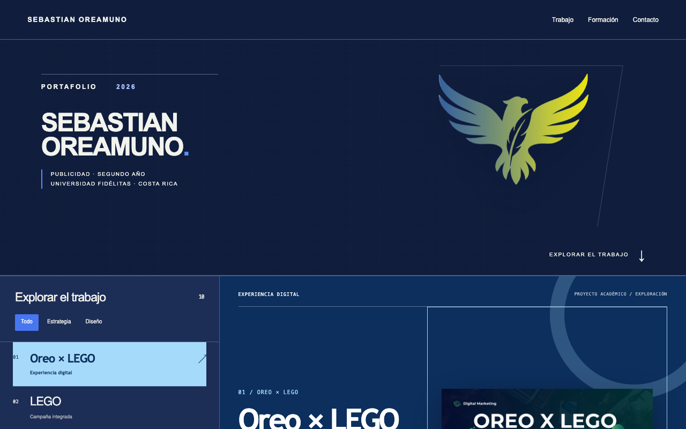

*Current public website: [sebastianoreamuno.com](https://sebastianoreamuno.com). Academic projects are presented as student work.*
