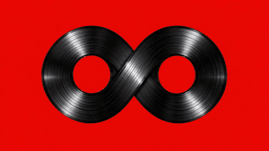
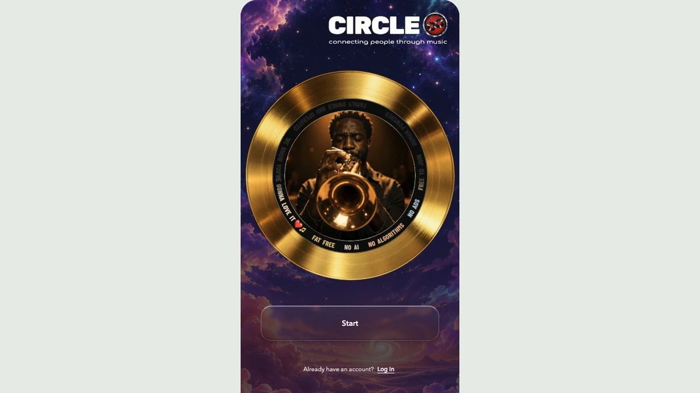
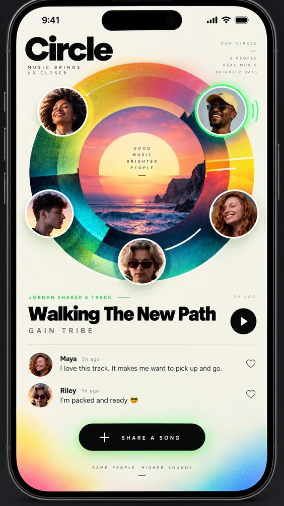
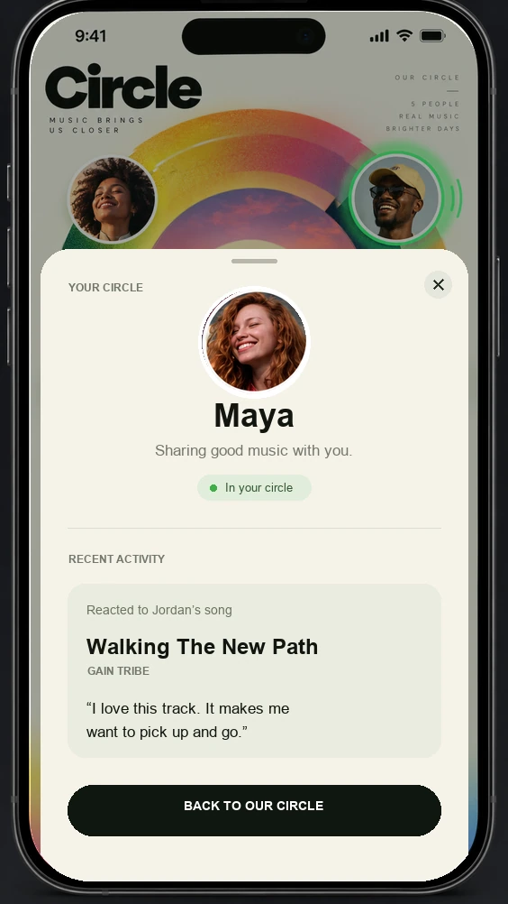
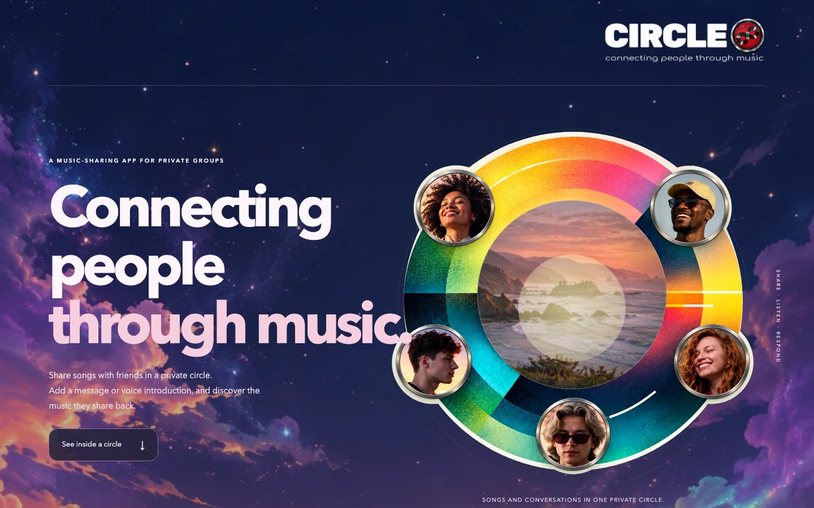

# Circle8

Songs mean more when you know who sent them, and why.

**Web + phone app · Private source code**

*Brand animation · not an app recording*

## The idea

Give a small circle of people a personal way to share music, messages and voice introductions.

## Design focus

Explore the people, the song and the response as one experience, with a shared web foundation packaged for Android and iPhone.

**Built with:** HTML · CSS · JavaScript · Capacitor · Supabase

Built from Ignacio’s design baseline. The extra circle/member screens are earlier interaction studies with fictional members. The loop is brand motion, not a demonstration of current app use.

## Screens and frames

### An invitation into the music

*App welcome design from the reviewed portfolio.*

### The people around the song

*Earlier interaction study · fictional members and messages.*

### The person behind a reaction

*Earlier member-view study · fictional person and activity.*

### A public introduction

*Website design capture from the reviewed portfolio.*

[Back to the project index](../README.md)
