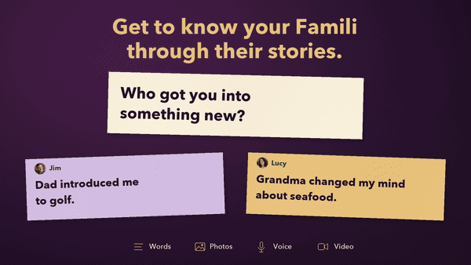
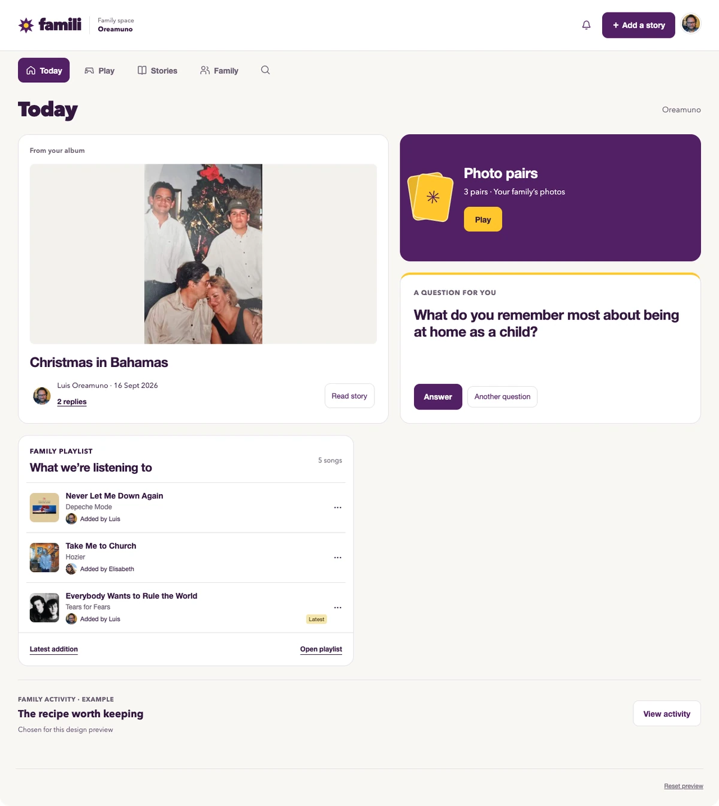
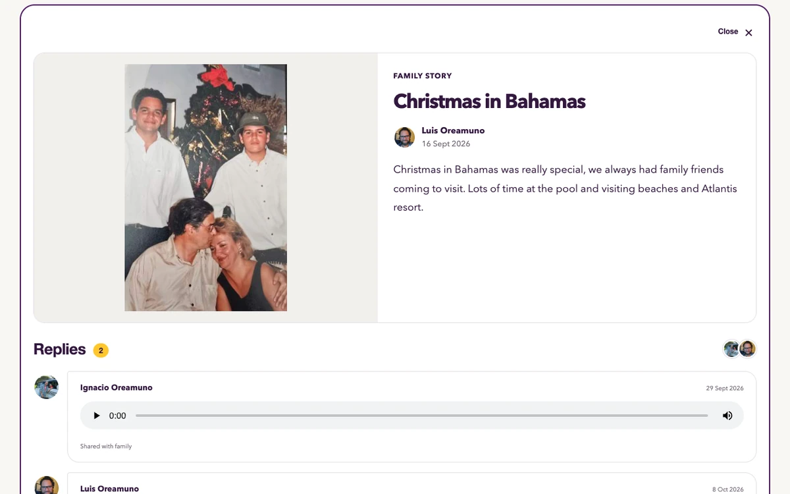
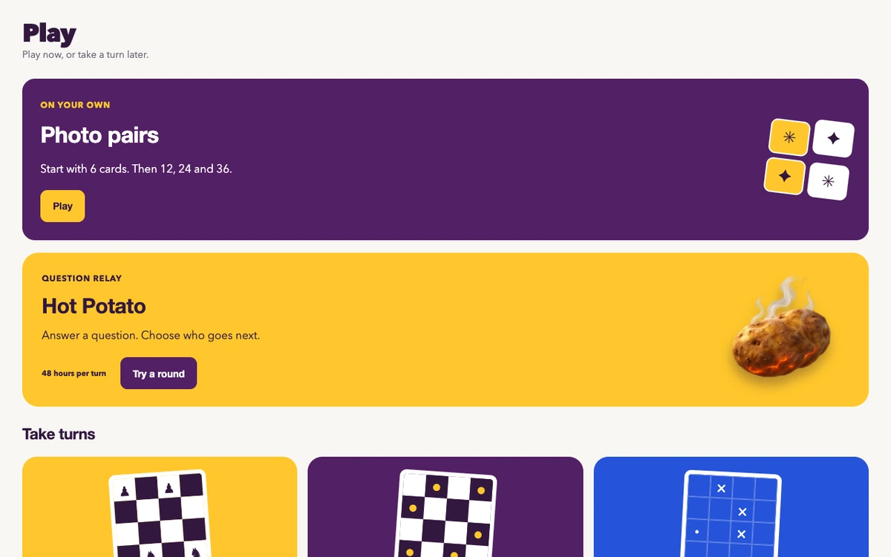
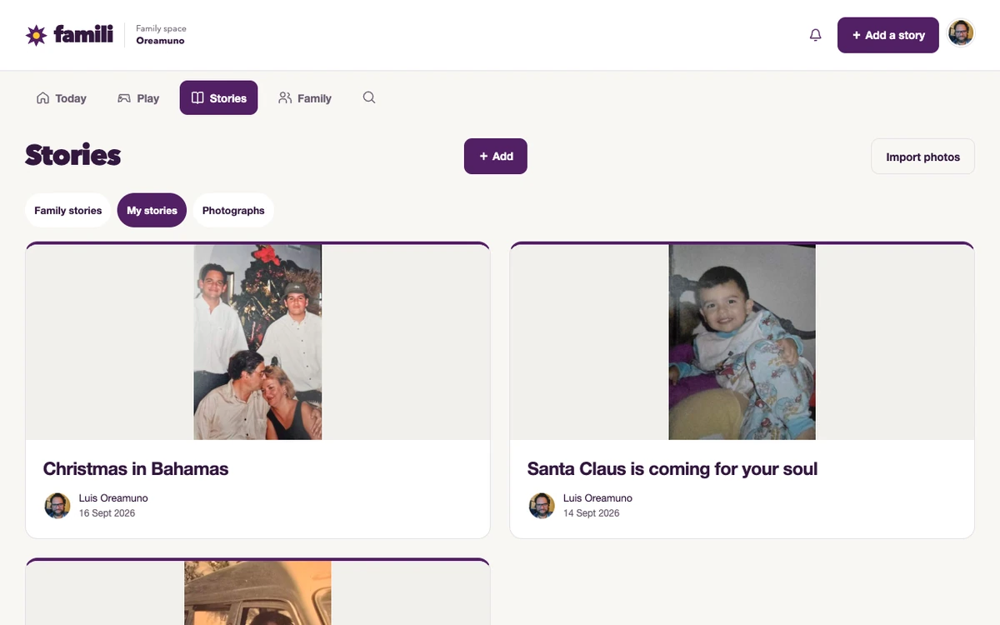
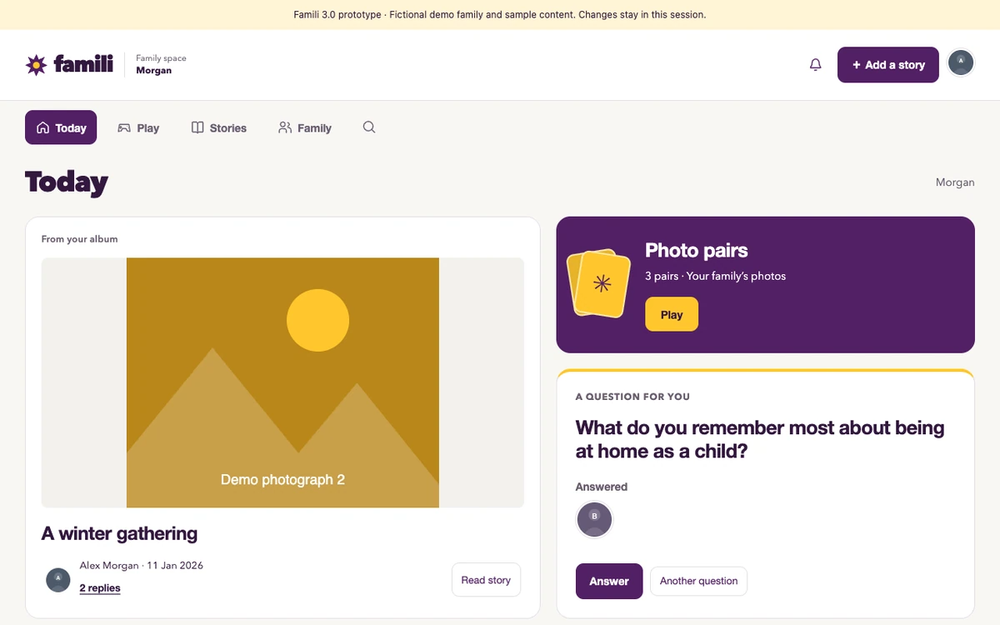

# Famili

A place for family stories, voices and the memories between them.

**Design prototype · Private source code**

*Concept film · example dialogue*

## The idea

Make contributing to a family archive feel as natural as remembering something together.

## Design focus

Connect a shared question, a story, its replies and light play. The 3.0 interface is explored separately from the existing app.

**Built with:** HTML · CSS · JavaScript · Supabase in the existing app

My own family use informs the project. Screens combine family photographs with example prototype content. The film includes fictional dialogue.

## Screens and frames

### A reason to come back

*Today · a question, the family playlist and a memory from the archive.*

### The story continues

*Story and replies · family photographs with example prototype content.*

### A lighter way in

*Play · Photo Pairs and Hot Potato in the local prototype.*

### An archive with a human face

*Stories · family photographs in the local design preview.*

### See who has answered

*Question response study · fictional demo people and activity.*

[Famili website](https://famili.me)

[Back to the project index](../README.md)
