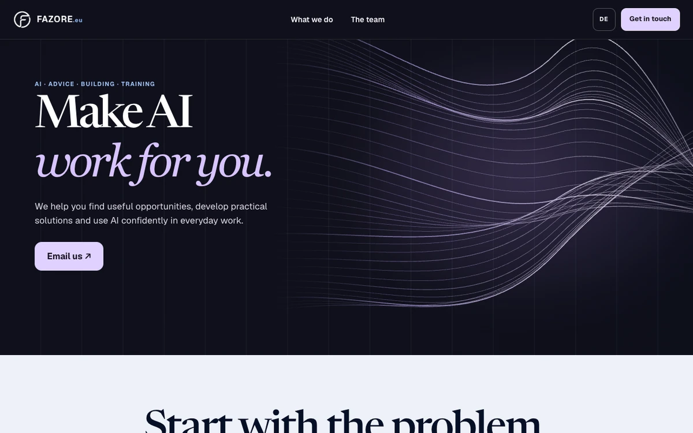
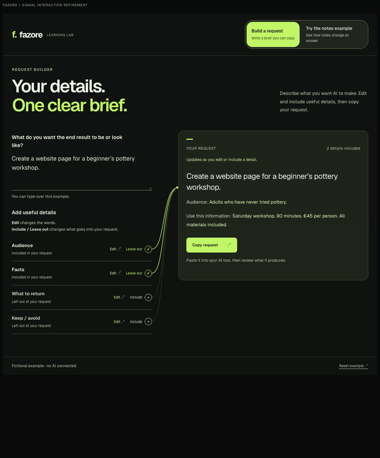
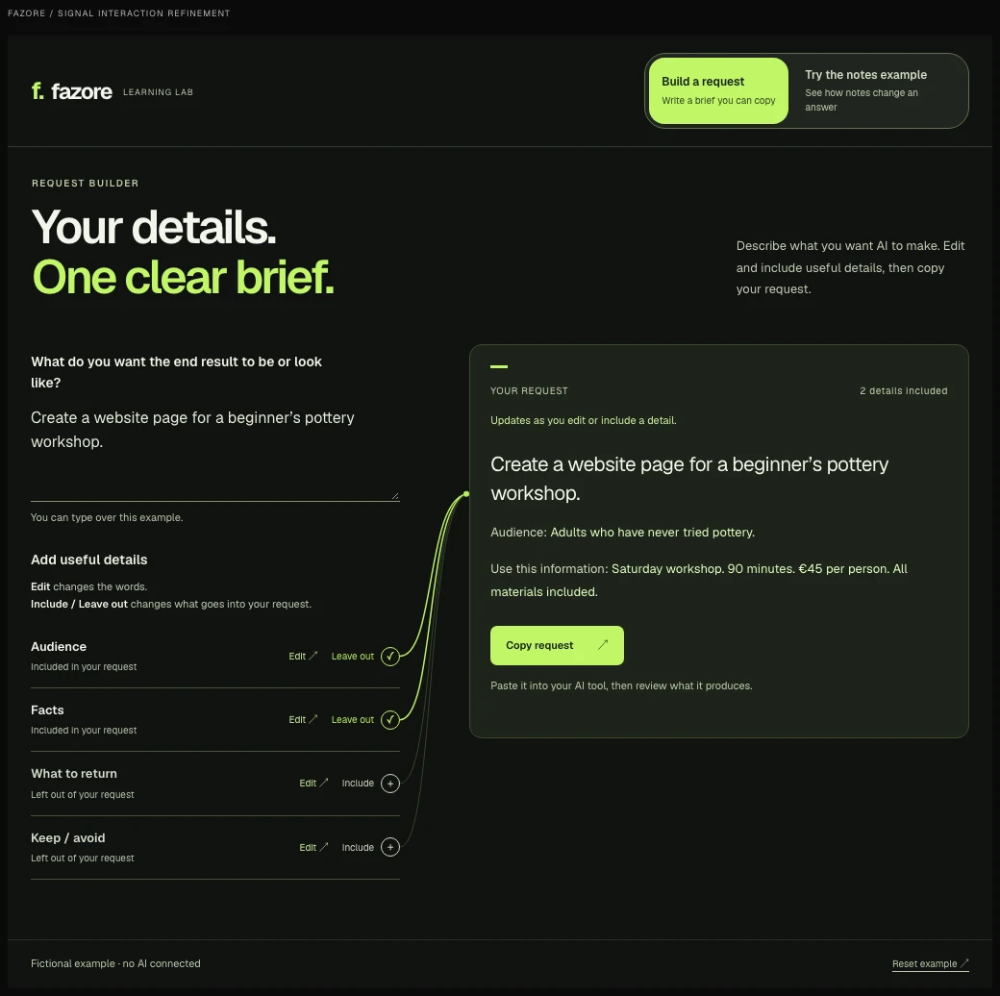
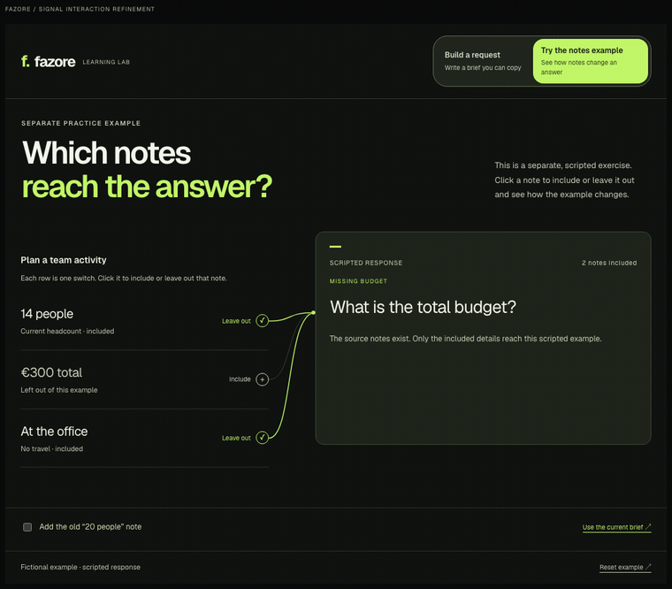

# Fazore

Making AI useful in everyday work.

A website and two learning experiments: build a clearer request, then try what happens when useful notes are left out.

## Explain the offer

A public introduction to Fazore’s advice, building and training work.

*Existing Fazore website capture.*

## Build a better prompt

Edit a useful detail, include it, and watch the request change.

*Accepted Signal interface · fictional example; no AI connected.*

See full screenshot

## See what context changes

Include a note, leave it out, or add an old one to see what changes.

*Accepted Signal notes exercise · fictional notes and scripted responses.*

See full screenshot

**Built with:** HTML · CSS · JavaScript · Vercel

### The interface

I wanted the connection to be visible: the details on the left feed the request on the right. Editing the words and including them are separate actions.

### What powers it

HTML, CSS and JavaScript handle the controls and live text. SVG lines connect the included details to the result and adjust as an editor opens.

### The learning examples

The request builder assembles a brief you can copy into an AI tool. The notes exercise uses a fictional team and scripted responses so you can see missing or conflicting information.

### The previews

These GIFs show states of the selected Signal prototype, including the inline editor. Full screenshots open below each preview.

[Fazore website](https://fazore.eu) · [Back to all projects](../README.md)
