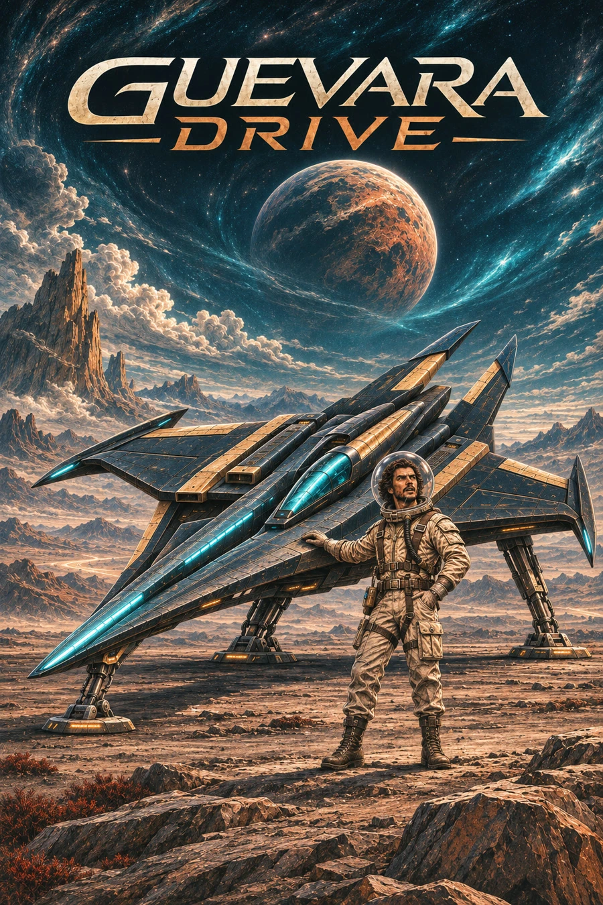
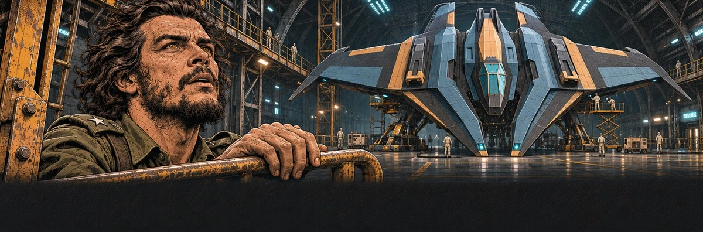
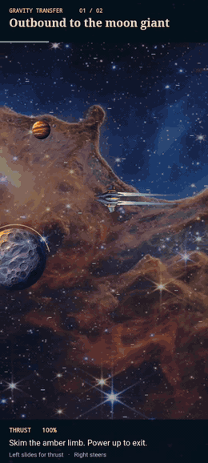
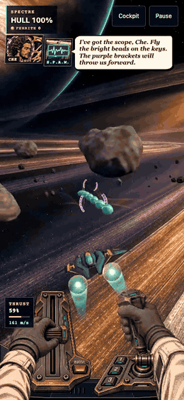
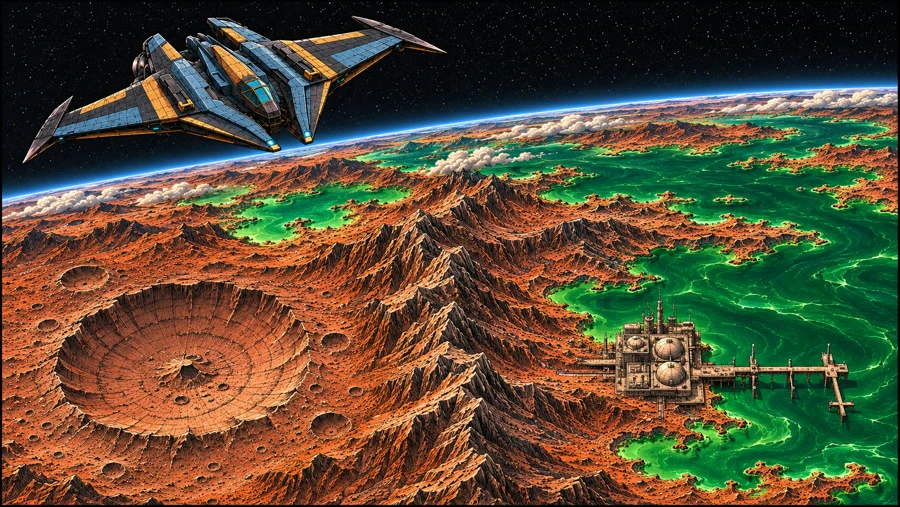
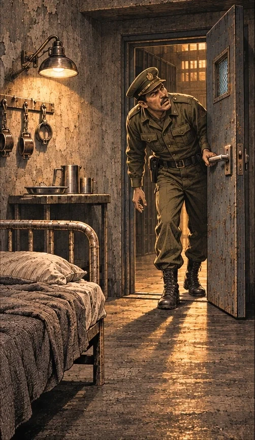
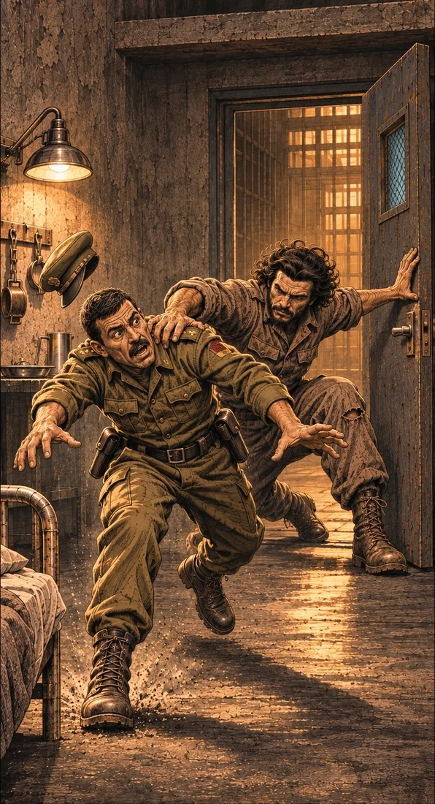
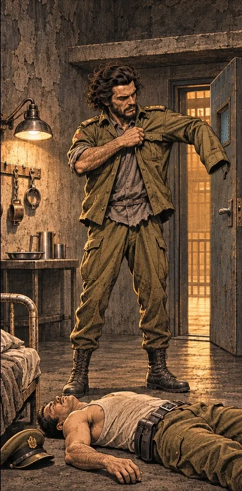
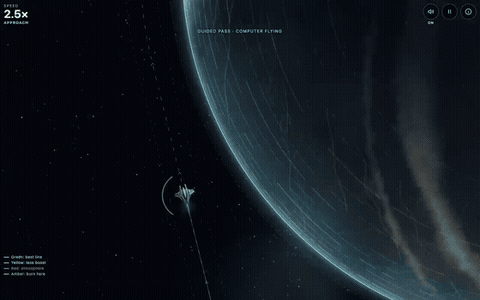
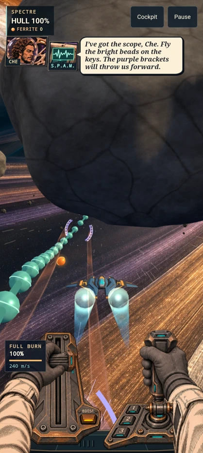

# Guevara Drive

*Personal creative study · work in progress*

## How far could I take it?

What would happen if I took one of my favourite historical figures, Che Guevara, put him in a graphic novel, and started adding gameplay?

Guevara Drive is my way of following that idea, blending comic storytelling with RPG elements and space exploration to see how far I can take it.

*Comic artwork from the escape sequence.*

## Trying the idea in motion

| | |
| --- | --- |
|  |  |
| Space exploration · prototype recording | Music-driven flight · prototype recording |

*Exploring the world beyond the escape.*

More comic art &amp; flight studies

| | | |
| --- | --- | --- |
|  |  |  |

*Comic illustrations from the escape sequence.*

*Earlier slingshot study · computer-guided recording.*

*Flight prototype · Android playtest capture.*

**Built with:** HTML · CSS · JavaScript · Canvas 2D · Three.js / WebGL · Android playtest builds.

Artwork and clips from the project's prototypes.

[Back to all projects](../README.md)
