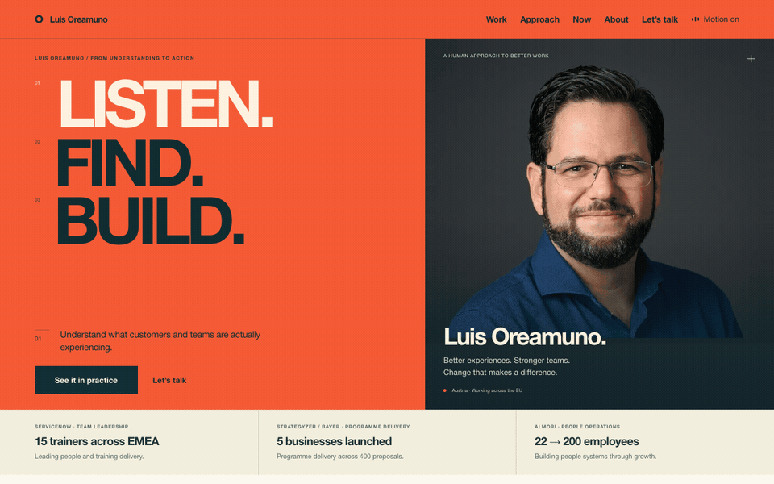
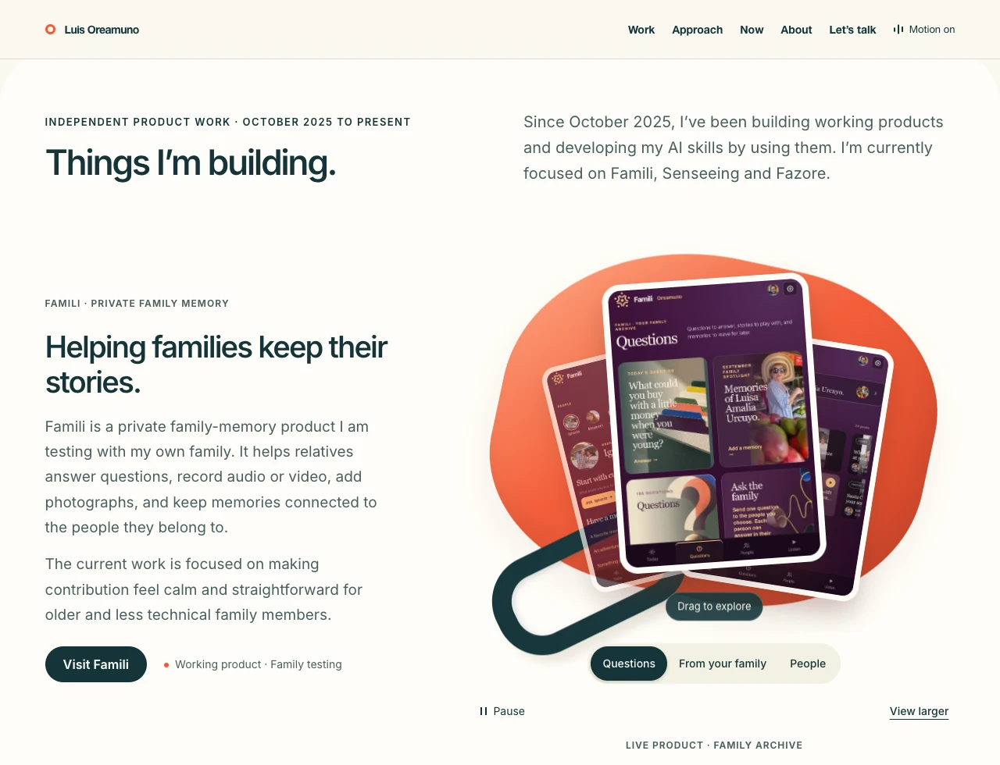
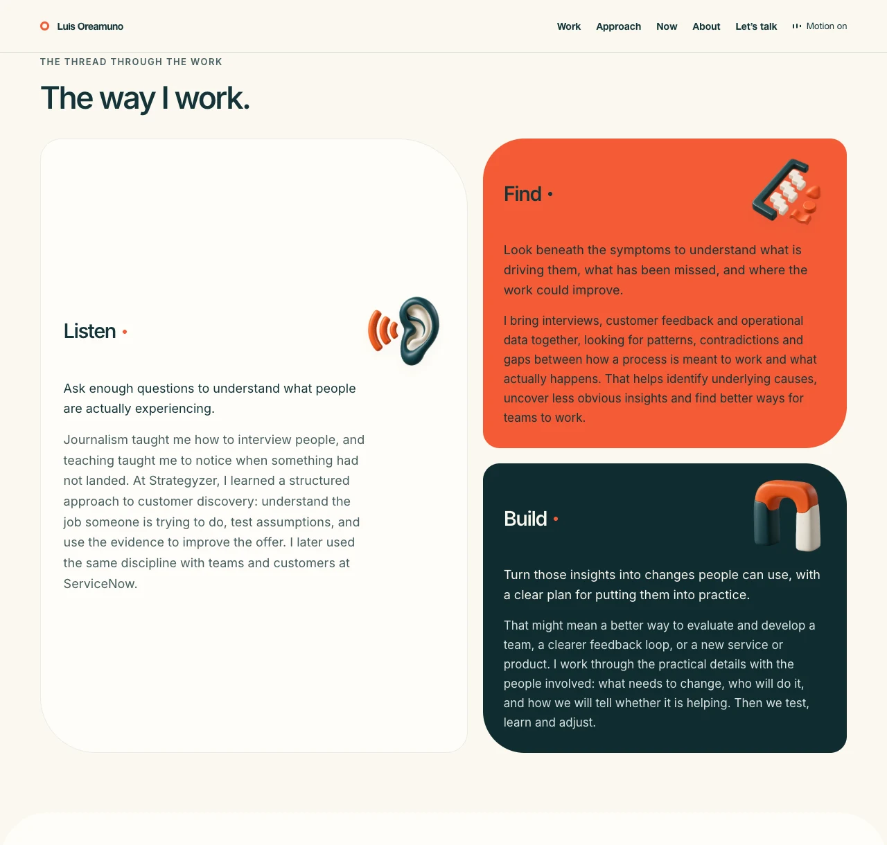
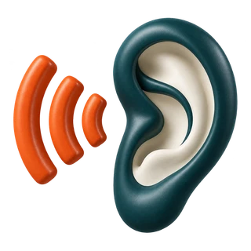
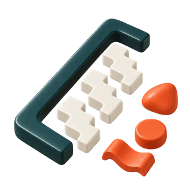
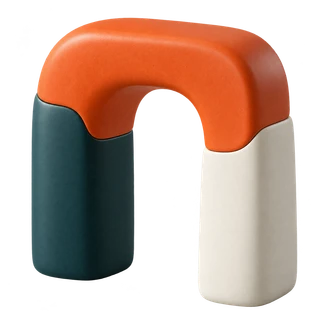

# Luis Oreamuno

A bit about me, the work I’ve done, and the things I’m building now.

*Three states from the live website.*

## Putting it all together

I wanted one place where you could get a feel for me and see what I’m working on. My background, the projects, and a bit of how I think.

## Listen. Find. Build.

That’s roughly how I work. Ask questions, figure out what’s actually going on, then try to make things better. I used that idea to pull the site together.

## The website

*Famili, Senseeing, Fazore, and where I’m at with each of them.*

*A bit more about what Listen, Find, Build means to me.*

## What went into it

**Made with:** HTML · CSS · JavaScript.

### The starting material

My portrait, team photos, pictures of the places I’ve lived, and real screens from Famili, Senseeing and Fazore. I wanted the site to show the work and a bit of the person behind it.

### Images made for the site

We used AI image generation to create the sculptural illustrations: an ear for Listen, shapes grouped into a pattern for Find, and pieces fitting together for Build. We tried a few versions and adjusted the colours to work with the site’s orange, teal and ivory.

### Motion and interaction

The movement is built into the page with CSS and JavaScript. The illustrations gently move and respond to the pointer. Product screenshots sit in stacks you can drag through, and photos move as you explore the places I’ve lived. There’s a motion switch, too, so you can turn it off.

### Getting it to feel right

This went through several visual studies and prototypes. A lot of the work was in getting the words, imagery and movement to feel like they belonged together, then refining the layouts and interactions for desktop and phone.

Captures from the live site, 24 November 2026.

[Have a look](https://www.luisoreamuno.com/en)

[Back to all projects](../README.md)
