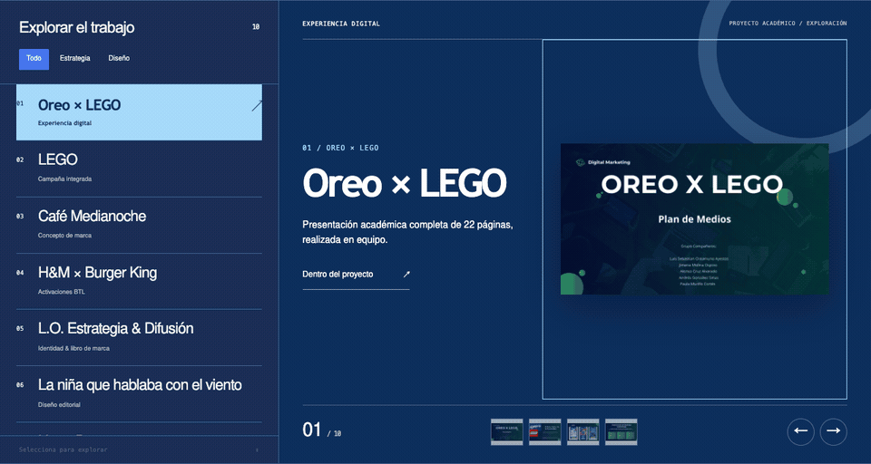
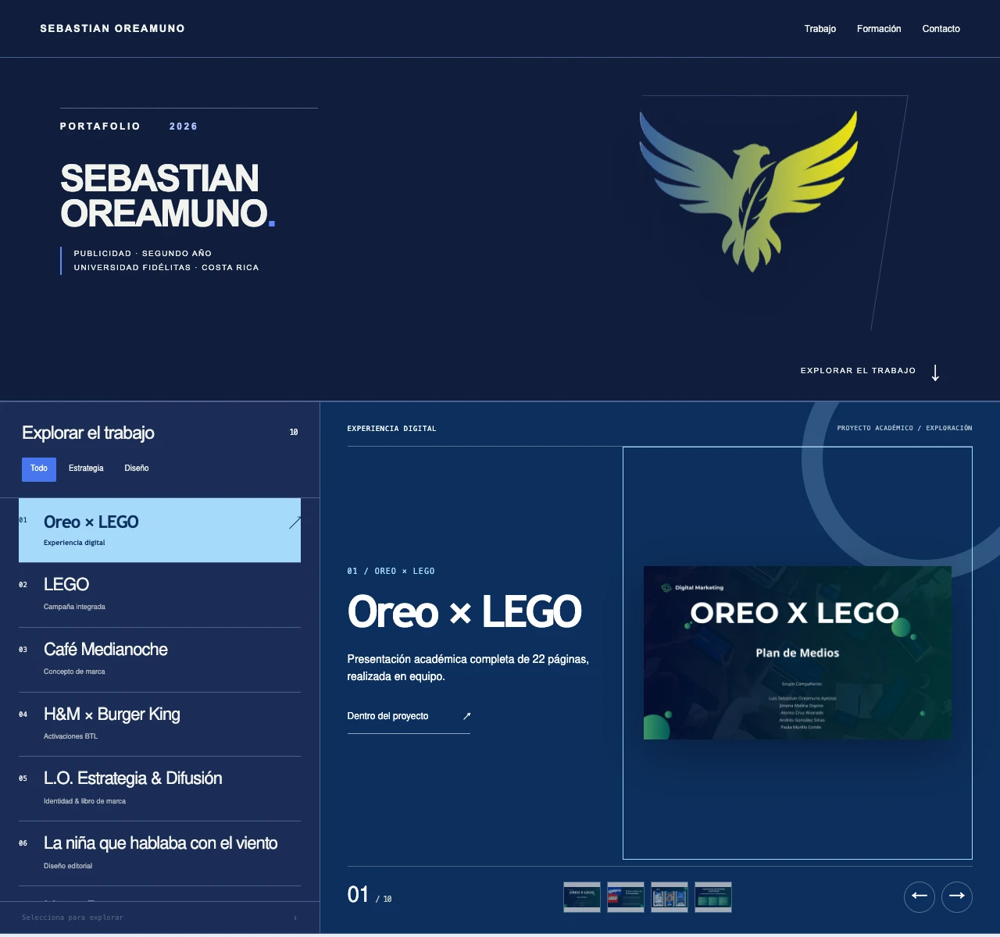
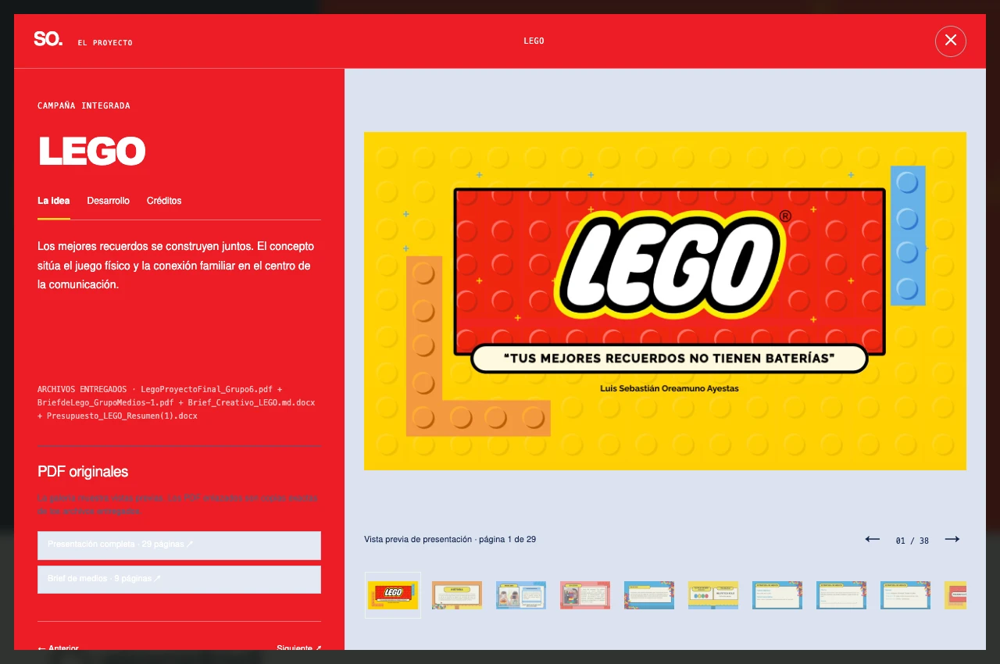

# Sebastian Oreamuno

I built this for my son, Sebastian, while he’s studying advertising. A place for his university work, with room to keep adding to it.

I designed and built the website. The coursework comes from Sebastian’s university portfolio, including group projects.

*Three selections from the live site.*

## From a folder to a portfolio.

The starting point was a collection of campaigns, presentations, logos and design exercises. I wanted to make it easy to browse, open something that catches your eye, and get into the work.

## Give each project some space.

Some are campaigns. Others are posters, books or identity work. The index holds it all together, while the featured area changes with each project.

## His own place for the work.

*Sebastian’s identity and the project index, captured from the current site.*

## Go beyond the cover.

*The project view puts the idea, presentation pages and original PDFs together.*

## What went into it

**Made with:** HTML · CSS · JavaScript · PDF & artwork previews.

### The starting material

PDF presentations, Illustrator artwork and the previews available from InDesign. We turned that material into images for the browser, grouped related files into the same project, and kept the original PDFs available to open.

### The visual design

The site uses the identity artwork already in his portfolio, a navy base, bold type and the colours of the projects themselves. This one is built around the artwork and documents he already had.

### Interaction and motion

The left-hand index changes the featured project. You can filter by strategy or design, step through the images, enlarge them and open the original presentation. CSS and JavaScript handle the transitions, with reduced-motion settings respected.

### Making the files useful

A presentation can run to dozens of pages. The galleries let you look through the full sequence, with thumbnails to move around. The original PDFs stay a click away when you want to read the complete document.

Captured from sebastianoreamuno.com on 24 November 2026.

[Have a look](https://sebastianoreamuno.com/)

[Back to all projects](../README.md)
