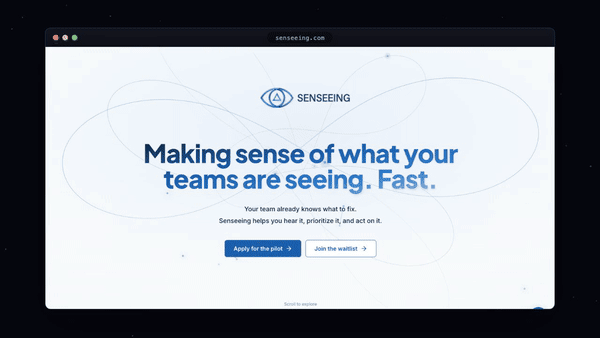
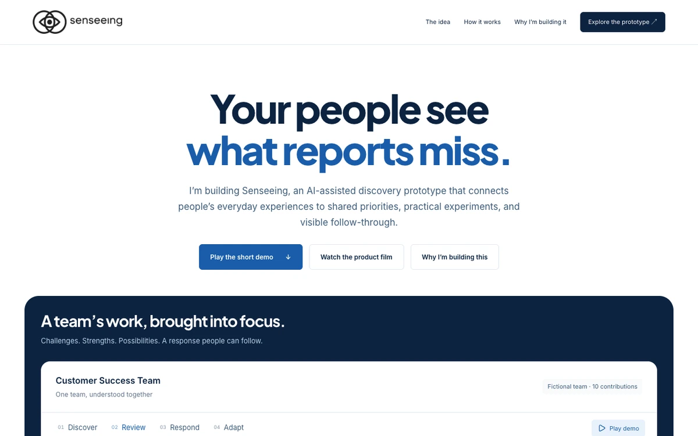
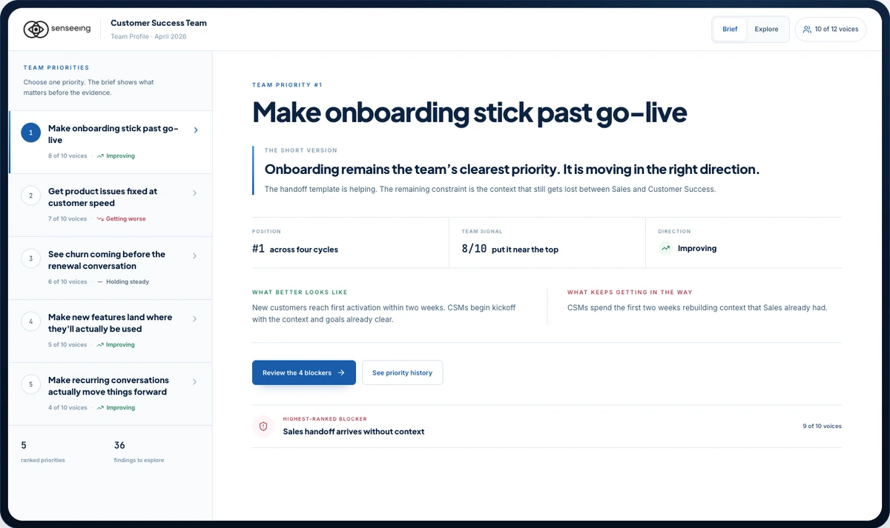

# Senseeing

Turn what a team sees into shared priorities and a response people can follow.

**Product prototypes · Private source code**

*Earlier website tour*

## The idea

Explore the gap between what people experience and what reaches the decision makers.

## Design focus

Move from contributions to a ranked team picture, with the next action visible. The public HTML website and the product code are separate surfaces.

**Built with:** Next.js / React · TypeScript · PostgreSQL / Prisma

The loop is an existing earlier website tour. The team screen uses demo data. These are development views, not a claim of the latest live product state.

## Screens and frames

### Explain the idea

*Website capture from the published portfolio review.*

### Bring a team’s priorities into focus

*Earlier team-priority prototype · demo team data. Cropped to the complete application frame.*

[Senseeing website](https://senseeing.com)

[Back to the project index](../README.md)
